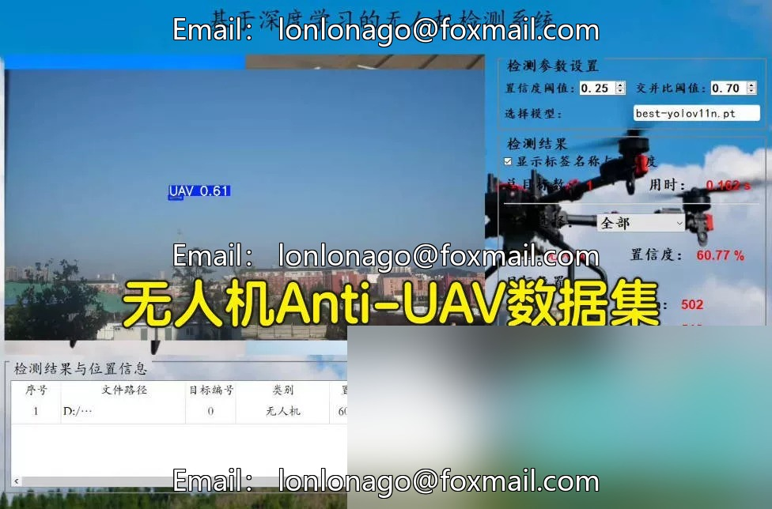
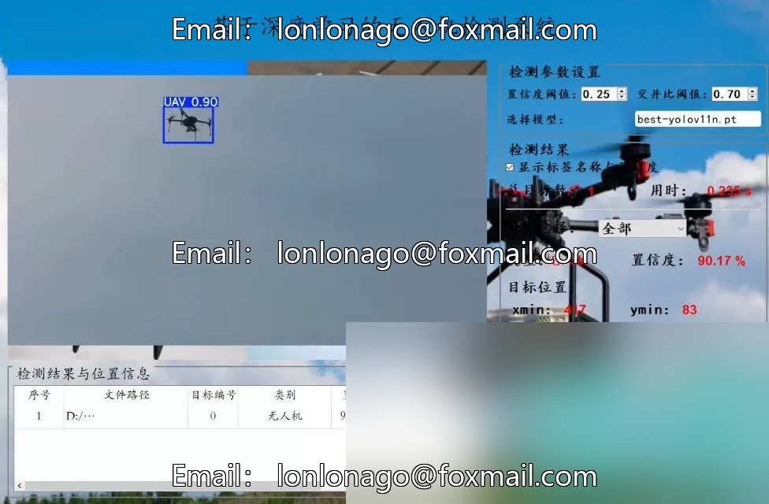
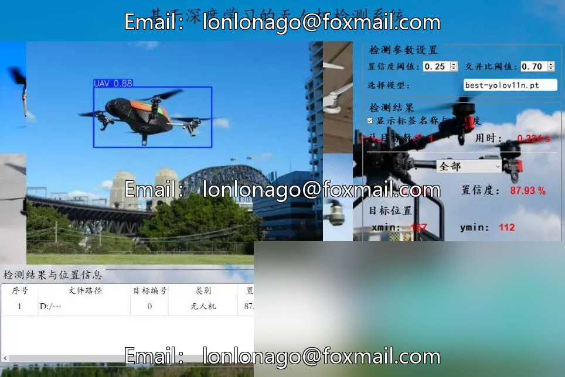
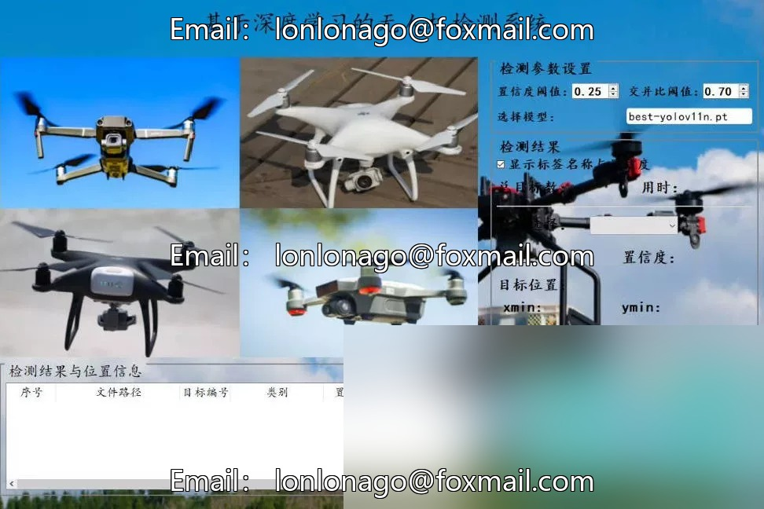

# YOLOv11-based drone detection system

## Body

YOLOv11-based drone detection system
Including UAV Anti-UAV dataset
Training set 5200, validation set 2600, test set 2200
Dataset configuration file
Model trained with 150 epochs, training results
Can adjust confidence, intersection over union, and select models
Can also replace models independently and use this interface to customize detection targets

Complete source code source files + labeled dataset + trained models + environment configuration tutorials + program running instructions document
Python + PyQt5 visualization interface

web-based shipment, can be directly photographed and shipped.

This system is a YOLOv11-based UAV detection system, including the UAV Anti-UAV dataset, training/validation/test splits, configuration files, a trained model with 150 epochs, adjustable detection parameters, custom detection targeting, multi-modal recognition, and a Python PyQt5 visualization interface.

<!-- AI_ENRICHED -->

## Images

## Payment

Here is a pay link on Stripe ( https://buy.stripe.com/3cs8yP7sY87d0vu9AB ). Please contact me lonlonago@foxmail.com after funding $89, and I will send you a complete data files , thank you!

